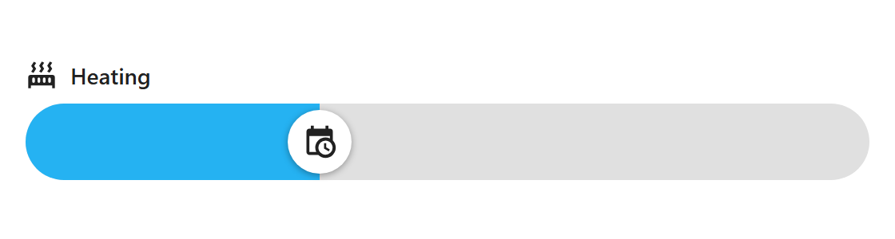
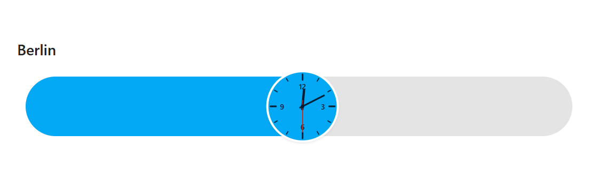
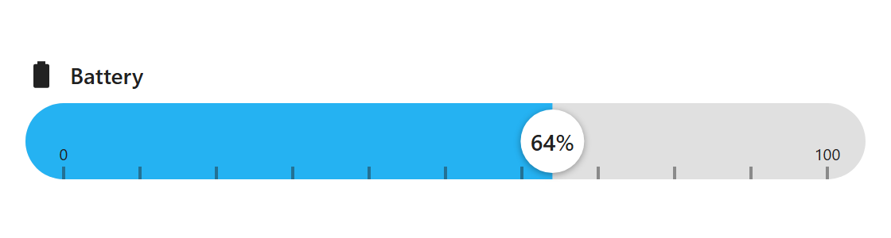

<h1>
  <picture>
    <source media="(prefers-color-scheme: dark)" srcset="https://raw.githubusercontent.com/arboeh/slABton/main/docs/assets/heading-dark.svg">
    
  </picture>
</h1>

[](https://github.com/arboeh/slABton/actions/workflows/ci.yml)
[](https://github.com/arboeh/slABton/security/code-scanning)
[](https://codecov.io/gh/arboeh/slABton)
[](https://slabton.de/de/)
[](https://github.com/arboeh/slABton/actions/workflows/hacs.yml)
[](https://github.com/arboeh/slABton/releases)
[](LICENSE)

Slider-Button-Bar-Karte für Home Assistant: eine Bar mit verschiebbarem Griff-Button.
Mehrere Zustände schalten, per Swipe sperren / entsperren oder einen Wert anzeigen.

**[Dokumentation](https://slabton.de/de/)** · **[Live-Demo](https://slabton.de/de/demo/)** · [English version](README.md)

**Installation:** in HACS nach **slABton** suchen ([Details](#installation)).


<picture>
  <source media="(prefers-color-scheme: dark)" srcset="https://raw.githubusercontent.com/arboeh/slABton/main/docs/assets/shots/state-dark.png">
  
</picture>
<picture>
  <source media="(prefers-color-scheme: dark)" srcset="https://raw.githubusercontent.com/arboeh/slABton/main/docs/assets/shots/clock-analog-dark.png">
  
</picture>
<picture>
  <source media="(prefers-color-scheme: dark)" srcset="https://raw.githubusercontent.com/arboeh/slABton/main/docs/assets/shots/value-scale-dark.png">
  
</picture>

## Funktionen

- Modi: `state`, `lock`, `value`, `counter`, `timer`, `clock` (digital und analog)
- Griffformen, Griffpositionen und Überstand; horizontal und vertikal, `ltr` und `rtl`
- Aktionen Klick, Doppelklick, Halten und Ziehen; Pfeiltasten bei `input_number` / `number` / `cover`
- Text in der Bar mit einfachen Platzhaltern (ohne Templates), Skala mit Beschriftung, innen oder außerhalb der Bar
- Covers (`cover.*`): Ziehen setzt die Position, Tippen öffnet oder schließt, Halten stoppt, die Fahrt wird live gezeigt
- Bar-Wert aus einem Entity-Attribut (`bar.attribute`), zum Beispiel Cover-Position oder Climate-Temperatur
- Farben, Schriftgrößen und CSS-Variablen; Theme-fähig; beachtet reduzierte Bewegung
- Texte auf Deutsch und Englisch, visueller Editor

## Installation

### HACS

[](https://my.home-assistant.io/redirect/hacs_repository/?owner=arboeh&repository=slABton&category=plugin)

1. HACS öffnen und nach **slABton** suchen.
2. **slABton** herunterladen, Browser neu laden.

Rückfall, falls die Suche es nicht findet: HACS, Dreipunktmenü, **Benutzerdefinierte Repositories**,
`https://github.com/arboeh/slABton` hinzufügen, Typ **Dashboard**, danach wie oben installieren.

### Manuell

1. `dist/slabton.js` nach `/config/www/slabton.js` kopieren.
2. Dashboard-Ressource anlegen: URL `/local/slabton.js`, Typ **JavaScript-Modul**.

## Schnellstart

```yaml
type: custom:slabton-card
entity: input_select.heating_mode
```

Der Modus folgt der Domain der Entity: `lock` / `alarm_control_panel` ergeben `lock`, `sensor` / `number` /
`input_number` ergeben `value`, `counter` ergibt `counter`, `timer` ergibt `timer`, alles andere `state`.
`input_datetime` / `input_date` und `clock` brauchen ein ausdrückliches `mode:`.

Alle Optionen, Beispiele und Screenshots stehen auf der Website:

- [Konfiguration](https://slabton.de/de/configuration/): allgemeine Optionen
- [Modi](https://slabton.de/de/modes/): state, lock, value, counter, timer, clock
- [Darstellung](https://slabton.de/de/appearance/): Bar-Wert, Platzhalter, Text, Skala, Header, Styling
- [Referenz](https://slabton.de/de/reference/): Sprachen, reservierte Namen, Entwicklung, Roadmap

Swipe zum Sperren / Entsperren ist eine Komfortgeste, **keine Sicherheitsgrenze**. Siehe [SECURITY.md](SECURITY.md).

## Entwicklung

```bash
npm install
npm run lint
npm test
npm run build
```

`dist/slabton.js` ist die einzige Release-Datei. Die Quellen der Website liegen in `docs/` und `docs-de/` (Zensical);
Quellcode-Aufbau und das Hinzufügen einer Sprache stehen in der [Referenz](https://slabton.de/de/reference/).

## Lizenz

[Mozilla Public License 2.0](LICENSE) (MPL-2.0)

<picture>
  <source media="(prefers-color-scheme: dark)" srcset="https://raw.githubusercontent.com/arboeh/slABton/main/docs/assets/logo-dark.svg">
  
</picture>
