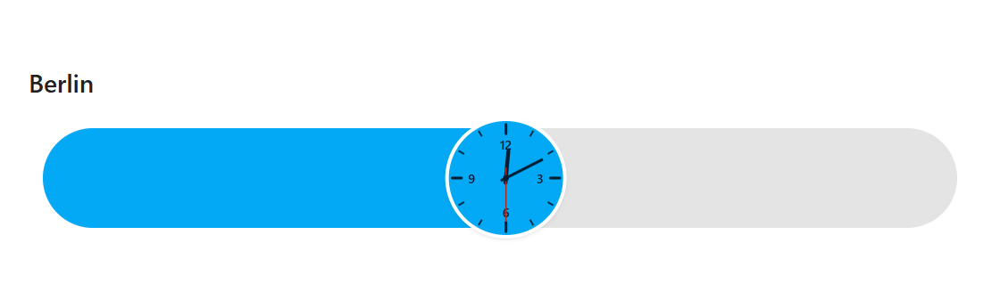

# slABton

[](https://github.com/arboeh/slABton/actions/workflows/ci.yml)
[](https://github.com/arboeh/slABton/actions/workflows/hacs.yml)
[](LICENSE)
[](https://hacs.xyz)

Slider button bar card for Home Assistant: a bar with a movable handle button.
Switch through several states, swipe to lock / unlock, or show a value.

**[Documentation](https://slabton.de)** · **[Live demo](https://slabton.de/demo/)** · [Deutsche Version](README.de.md)





## Features

- Modes: `state`, `lock`, `value`, `counter`, `timer`, `clock` (digital and analog)
- Handle shapes, positions and overhang; horizontal and vertical, `ltr` and `rtl`
- Drag, tap, double tap and hold actions; arrow keys for `input_number` / `number`
- Text in the bar with simple placeholders (no templates), tick scale with labels
- Colors, font sizes and CSS variables; theme aware; respects reduced motion
- English and German texts, visual editor

## Installation

### HACS (custom repository)

1. HACS, three-dot menu, **Custom repositories**.
2. Add `https://github.com/arboeh/slABton`, type **Dashboard**.
3. Install **slABton**, reload the browser.

### Manual

1. Copy `dist/slabton.js` to `/config/www/slabton.js`.
2. Add a dashboard resource: URL `/local/slabton.js`, type **JavaScript module**.

## Quick start

```yaml
type: custom:slabton-card
entity: input_select.heating_mode
```

The mode follows the entity domain: `lock` / `alarm_control_panel` give `lock`, `sensor` / `number` /
`input_number` give `value`, `counter` gives `counter`, `timer` gives `timer`, everything else gives `state`.
`input_datetime` / `input_date` and `clock` need an explicit `mode:`.

All options, examples and screenshots are on the website:

- [Configuration](https://slabton.de/configuration/): general options
- [Modes](https://slabton.de/modes/): state, lock, value, counter, timer, clock
- [Appearance](https://slabton.de/appearance/): bar value, placeholders, text, scale, header, styling
- [Reference](https://slabton.de/reference/): languages, reserved names, development, roadmap

Swipe to lock / unlock is a convenience gesture, **not a security boundary**. See [SECURITY.md](SECURITY.md).

## Unavailable entities

While the entity is `unavailable` or `unknown`, the handle shows a warning icon. The reason is in the tooltip and for
screen readers. The card is locked: a tap opens more-info, gestures and arrow keys do nothing.

- `allow_unavailable_actions: true` (mode `state` only, default `false`) keeps tap, hold, double tap, drag and arrow
  keys active. Lock mode stays locked on purpose; other modes ignore the option with a warning.
- The lock covers `cycle`, `cycle_back` and `toggle` on the main entity. A `perform-action` you configure yourself is
  not blocked, even when it targets the main entity.
- With the option on, a tap on a toggle entity (`switch`, `light`, ...) in an unknown state sends `off` first (the
  first state of the cycle). A `select` without its option list sends nothing.
- The handle stays focusable while locked (`aria-disabled="true"`) so Enter / Space can open more-info.
- Template entities: keep `availability` independent of optional helper entities. A missing helper locks the card.

## Development

```bash
npm install
npm run lint
npm test
npm run build
```

`dist/slabton.js` is the only release file. The website sources are in `docs/` (MkDocs);
see the [reference](https://slabton.de/reference/) for the source layout and how to add a language.

## License

[Mozilla Public License 2.0](LICENSE) (MPL-2.0)
