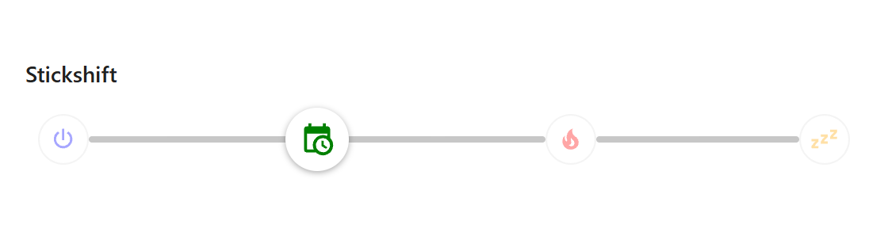
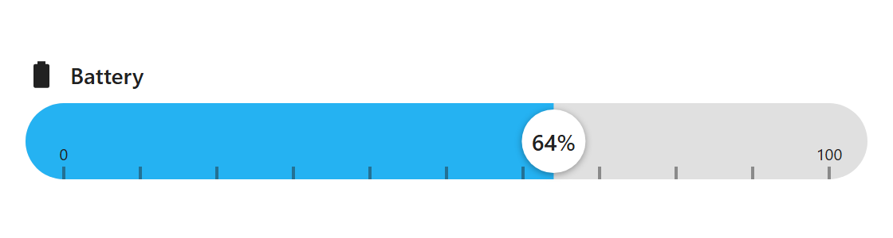
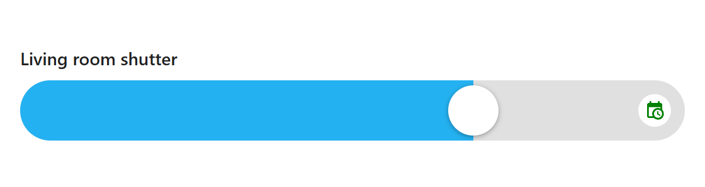
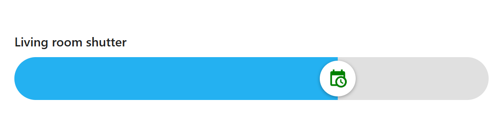

<h1>
  <picture>
    <source media="(prefers-color-scheme: dark)" srcset="https://raw.githubusercontent.com/arboeh/slABton/main/docs/assets/heading-dark.svg">
    
  </picture>
</h1>

[](https://github.com/arboeh/slABton/actions/workflows/ci.yml)
[](https://github.com/arboeh/slABton/security/code-scanning)
[](https://codecov.io/gh/arboeh/slABton)
[](https://slabton.de)
[](https://github.com/arboeh/slABton/actions/workflows/hacs.yml)
[](https://github.com/arboeh/slABton/releases)
[](LICENSE)

Slider button bar card for Home Assistant: a bar with a movable handle button.
Switch through several states, swipe to lock / unlock, or show a value.

**[Documentation](https://slabton.de)** · **[Live demo](https://slabton.de/demo/)** · [Deutsche Version](README.de.md)

**Install:** search for **slABton** in HACS ([details](#installation)).


## Stickshift

A fixed gate with one point per state: tap a point and the entity jumps straight to that state.

<picture>
  <source media="(prefers-color-scheme: dark)" srcset="https://raw.githubusercontent.com/arboeh/slABton/main/docs/assets/shots/stickshift-dark.png">
  
</picture>

```yaml
type: custom:slabton-card
entity: input_select.heating_mode
stickshift: true
states:
  - { value: "Off", icon: mdi:power }
  - { value: "Auto", icon: mdi:calendar-clock }
  - { value: "On", icon: mdi:fire }
```

## Gallery

<picture>
  <source media="(prefers-color-scheme: dark)" srcset="https://raw.githubusercontent.com/arboeh/slABton/main/docs/assets/shots/state-dark.png">
  
</picture>
<picture>
  <source media="(prefers-color-scheme: dark)" srcset="https://raw.githubusercontent.com/arboeh/slABton/main/docs/assets/shots/clock-analog-dark.png">
  
</picture>
<picture>
  <source media="(prefers-color-scheme: dark)" srcset="https://raw.githubusercontent.com/arboeh/slABton/main/docs/assets/shots/value-scale-dark.png">
  
</picture>
<picture>
  <source media="(prefers-color-scheme: dark)" srcset="https://raw.githubusercontent.com/arboeh/slABton/main/docs/assets/shots/switch-states-dark.png">
  
</picture>
<picture>
  <source media="(prefers-color-scheme: dark)" srcset="https://raw.githubusercontent.com/arboeh/slABton/main/docs/assets/shots/handle-zones-dark.png">
  
</picture>

## Features

- Modes: `state`, `lock`, `value`, `counter`, `timer`, `clock` (digital and analog)
- Handle shapes, positions and overhang; horizontal and vertical, `ltr` and `rtl`
- Drag, tap, double tap and hold actions; arrow keys for `input_number` / `number` / `cover`
- Text in the bar with simple placeholders (no templates), tick scale with labels, inside or outside the bar
- Covers (`cover.*`): drag sets the position, tap opens or closes, hold stops, travel is shown live
- Bar value from an entity attribute (`bar.attribute`), for example cover position or climate temperature
- Switches show the state of their own entity (icon and icon color per state, `switches.<slot>.states`); the handle has its own actions and icon per zone (`handle_zones`)
- Stickshift (`stickshift:`): a fixed gate with one clickable point per state, a tap jumps straight to a state, optional own action per point
- Material 3 look: tonal track, filled handle with an icon that stays readable on any color, hover, focus and press state layers
- Timer actions (`timer.start_action`, `timer.end_action`) and swipe to start or stop a timer
- Colors, font sizes and CSS variables; theme aware; respects reduced motion
- Quick start in the visual editor: pick a tile with a live preview (clock, timer, lock, thermometer), answer one question, done; the result is a normal config
- English and German texts, visual editor

## Installation

### HACS

[](https://my.home-assistant.io/redirect/hacs_repository/?owner=arboeh&repository=slABton&category=plugin)

1. Open HACS and search for **slABton**.
2. Download **slABton**, reload the browser.

Fallback if the search does not find it: HACS, three-dot menu, **Custom repositories**, add
`https://github.com/arboeh/slABton`, type **Dashboard**, then install as above.

### Manual

1. Copy `dist/slabton.js` to `/config/www/slabton.js`.
2. Add a dashboard resource: URL `/local/slabton.js`, type **JavaScript module**.

## Quick start

```yaml
type: custom:slabton-card
entity: input_select.heating_mode
```

The mode follows the entity domain: `lock` / `alarm_control_panel` give `lock`, `sensor` / `number` /
`input_number` give `value`, `counter` gives `counter`, `timer` gives `timer`, everything else gives `state`.
`input_datetime` / `input_date` and `clock` need an explicit `mode:`.

Switch with its own entity, an icon and color per state, and a script as `tap_action`:

```yaml
type: custom:slabton-card
entity: cover.living_room
switches:
  end:
    entity: sensor.cover_living_room_mode
    icon: mdi:calendar-clock
    tap_action:
      action: perform-action
      perform_action: script.cover_living_room_toggle_auto
    states:
      - { value: auto, icon: mdi:calendar-clock, color: green }
      - { value: heat_protection, icon: mdi:weather-sunny, color: orange }
      - { value: "off", icon: mdi:power, color: grey }
```

All options, examples and screenshots are on the website:

- [Configuration](https://slabton.de/configuration/): general options
- [Modes](https://slabton.de/modes/): state, lock, value, counter, timer, clock
- [Appearance](https://slabton.de/appearance/): bar value, placeholders, text, scale, header, styling
- [Reference](https://slabton.de/reference/): languages, reserved names, development, roadmap

Swipe to lock / unlock is a convenience gesture, **not a security boundary**. See [SECURITY.md](SECURITY.md).

## Development

```bash
npm install
npm run lint
npm test
npm run build
```

`dist/slabton.js` is the only release file. The website sources are in `docs/` and `docs-de/` (Zensical);
see the [reference](https://slabton.de/reference/) for the source layout and how to add a language.

## License

[Mozilla Public License 2.0](LICENSE) (MPL-2.0)

<picture>
  <source media="(prefers-color-scheme: dark)" srcset="https://raw.githubusercontent.com/arboeh/slABton/main/docs/assets/logo-dark.svg">
  
</picture>
